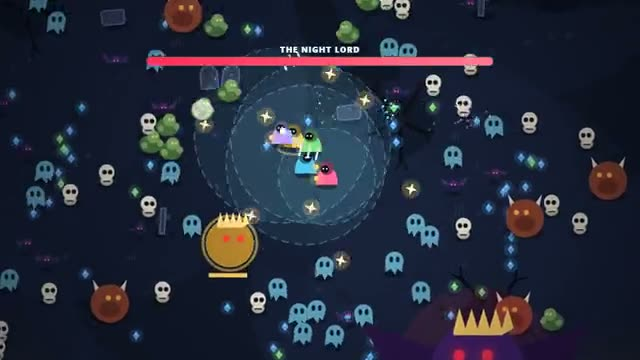

# Night Horde

Just move. Your weapons do the rest. Survive the night. A multiplayer starter game from [Multiplayer Agent](https://multiplayeragent.com): 2D, co-op, 1–4 players, with bots that fill empty seats.

## How it plays

Walk the graveyard while your weapons fire on their own. Grab the gems monsters drop to level up and pick an upgrade, stand by a downed friend to get them up, and beat the Night Lord at 10:00.

**Controls:** WASD, arrows or hold the mouse to walk, 1/2/3 to pick an upgrade; on touch, drag anywhere to walk and tap a card.

## Make it yours in the Game Builder

Open the [Game Builder](https://multiplayeragent.com), choose **Start from a starter game** and pick Night Horde. It opens as version 1 in your studio, ready to play and publish. Then ask for changes, for example:

- Add a fire bomb weapon that leaves burning ground
- Make it a frozen tundra with snow wolves instead of bats
- Let players pick a hunter with a different starting weapon

## Run it yourself

1. Get a free publishable key (`pk_…`) at [multiplayeragent.com](https://multiplayeragent.com).
2. In `index.html`, put it in place of `pk_REPLACE_ME` in the `MP_CONNECT` block.
3. Open `index.html` in a browser. No build step and no server needed.

Without a key it still runs, offline against bots.

## How it is built

- One `index.html`. The comment at the top of the script maps the code and explains the multiplayer.
- Monsters, waves, weapons and passives are plain tables near the top: add a row to add one.
- **Leaderboard:** Each player's most kills in one night, shown on the results card.
- **Bots:** Bots fill the team up to four hunters, each with its own build.
- **Host-run rules:** The host's browser runs the horde, the clock and the bots; if it leaves, the next player takes over.
- **Live sync:** Hundreds of monsters chase the team on every screen at once.
- `?attract` runs it offline with bots only. The preview video is recorded from it.

## License

MIT.
